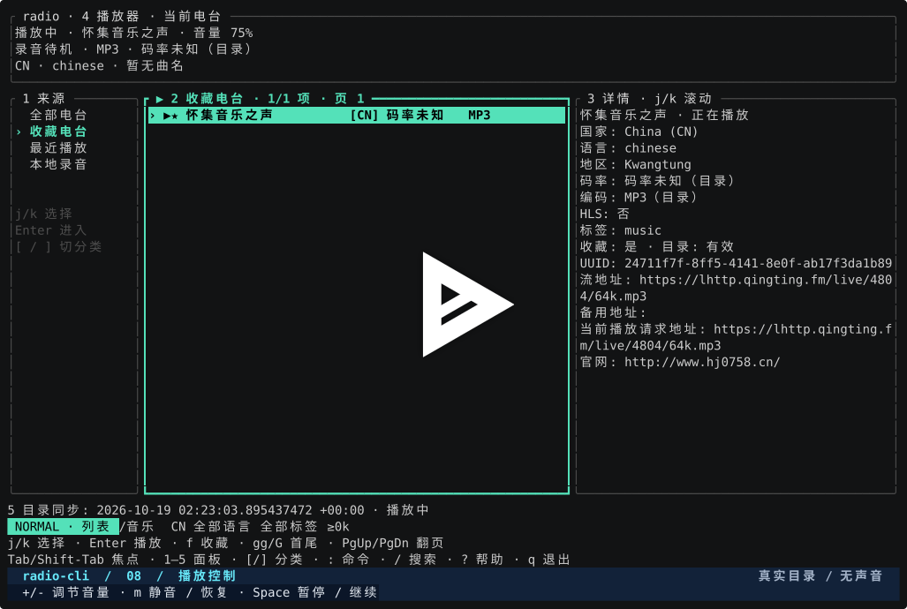

# radio-cli

[](https://github.com/hmgle/radio-cli/actions/workflows/ci.yml)
[](https://github.com/hmgle/radio-cli/releases/latest)
[](Cargo.toml)
[](#installation--quick-start)
[](LICENSE)

**English** | [简体中文](README.zh-CN.md)

A lightweight, Linux-first terminal radio. Rust manages the local catalog and interaction, SQLite stores favorites and history, mpv plays audio, and FFmpeg records streams losslessly. No account or API key required.

Linux is the primary platform. macOS supports the core CLI/TUI workflow:
catalog management, favorites and history, playback controls, recording,
and normal shutdown. Native Windows is not currently supported because the
code requires Unix APIs. CI tests Linux and macOS with real mpv and FFmpeg;
Linux checks also cover Rust 1.88, static x86_64 musl builds, and RustSec
dependency auditing.

Homepage: <https://github.com/hmgle/radio-cli>

## Demo

[](https://asciinema.org/a/1269102)

[Watch the 90-second demo on asciinema](https://asciinema.org/a/1269102) —
Chinese UI and captions, recorded in zsh without audio.

Browse a synced catalog, filter stations by `CN`, search, save favorites,
control playback, locate the playing station, view history, and record/replay
a short clip.

## Installation & Quick Start

Requires Rust 1.88+, mpv, and FFmpeg (including ffprobe). SQLite is compiled into the binary, so no SQLite command-line tools are needed.

Prebuilt Linux x86_64 binaries and checksums are available on the [releases page](https://github.com/hmgle/radio-cli/releases). The static binary needs no Rust toolchain; install mpv and FFmpeg separately. See the [changelog](CHANGELOG.md) for upgrade compatibility notes.

```sh
# Debian / Ubuntu
sudo apt install mpv ffmpeg
cargo build --release --locked
./target/release/radio doctor
./target/release/radio sync
./target/release/radio tui

# or install to ~/.cargo/bin
cargo install --path . --locked
```

On macOS, install Rust 1.88+ and the media tools with Homebrew, then build
from source (the release downloads are Linux binaries):

```sh
brew install rust mpv ffmpeg # omit rust if a suitable toolchain is installed
cargo install --path . --locked
radio doctor
radio sync
radio tui
```

Running `radio` directly opens the TUI in an interactive terminal; when output is redirected it prints help instead. With no catalog present, the TUI and `random` first fetch the top 1,000 stations; the full catalog is fetched with `sync`. A failed sync keeps the previous catalog.

## Commands

```sh
radio search jazz --country FR --min-bitrate 128
radio search 新闻 --language chinese
radio search --tag 'public radio' --limit 100 --offset 100
radio --json search jazz
radio info <UUID>
radio play <UUID>
radio play https://example.com/live.mp3
radio random --country CN
radio favorites add <UUID>
radio favorites list
radio favorites remove <UUID>
radio history
radio station add 'My Station' 'https://example.com/live' \
  --backup-url 'https://example.com/backup'
radio record <UUID> --duration 30m --output-dir ./recordings
radio recordings list
```

Name, country, language, and tag searches run locally; country code, language, and tag filters use full values (languages also accept the codes provided by the catalog, e.g. `zh`). The minimum-bitrate filter excludes records with unknown bitrate. `random` samples across the entire matching catalog and is not limited by search pagination. `info` always outputs JSON; query commands accept `--json`. Runtime status and diagnostics go to stderr.

Use `--json-v2` for atomic success/error envelopes and stable error codes; legacy
`--json` shapes remain unchanged. See the [JSON contract](docs/json-contract.md).
Recordings support `recordings play ID`, `recordings remove ID [--index-only]`,
and `recordings open`; TUI Enter / D / o / e provide playback, confirmed deletion,
directory opening and expanded errors. Disk checks reserve 16 MiB by default.

`play` also accepts an HTTP(S) stream URL; TUI `:play URL` does the same.
Direct URLs are temporary: they are never added to the catalog or history,
and do not replace the saved last station. Add a station first to record it.

Stations are identified by their full Radio Browser UUID; custom stations get a local UUID. Favorites, recently played entries, and custom addresses are never overwritten by a catalog sync. A favorite that has disappeared from the catalog can still be played. History keeps the last 1,000 successful playbacks; the interface aggregates it by station to show recent listening.

TUI keys:

| Key | Action |
|---|---|
| `:` | Command mode; Enter executes, Esc returns |
| `Tab` / `Shift-Tab` | Next / previous panel |
| `1`–`5` | Source / list / details / player / tasks panel |
| `Ctrl` + arrows / `Ctrl`+`h/j/k/l` | Switch panels by spatial position |
| Arrows / `j`, `k` | Select, navigate, or scroll the focused panel |
| `Enter` | Play in lists; view current station details in the player |
| `Space` / `m` | Pause / resume / mute; recording continues |
| `y` / `Y` | Copy UUID / URL (recording ID / path) via OSC 52 |
| `n` | Random next station under the current filter |
| `f` | Add / remove the selected station from favorites |
| `r` | Start / stop recording the current station |
| `+`, `-` | Volume |
| `/` | Incremental search; Enter confirms, Esc restores the previous search |
| `F` | Country, language, tag, and minimum-bitrate filters |
| `[` / `]` | Stations / favorites / recent / recordings categories |
| `gg` / `G` | First / last item in the list |
| `PgUp` / `PgDn` | Page through the station list |
| `?` | Open help or current failure details |
| `q` / `Ctrl-C` | Finalize recordings and quit |

The focused panel uses a bright cyan bold border, a `▶` marker, and a number; the bottom bar shows the mode and the focused panel's actions. Mouse clicks switch panels and select rows; double-click a station row to play it. The wheel navigates. The top bar continuously shows the current station, codec, bitrate, volume, and recording status; the details panel shows country, language, tags, UUID, address, and more. Bitrate and codec are labeled as catalog data and unknown values are explicitly shown as unknown; the current playback info does not change with list selection.

Inside the TUI, `:sync` runs a background sync, `:sync-cancel` cancels the task, `:current` shows full details of the current station, and `:record --duration 30m` schedules a timed recording of the current station. Commands support quoting, Tab completion, and history; see the [TUI guide](docs/tui.md) for more commands and interaction design (in Chinese).

## Configuration & Data

Select the CLI error and list language with `--lang en` or `--lang zh-CN`.
Precedence is `--lang`, `RADIO_LANG`, config `language`, then `LC_ALL`/`LANG`;
unknown languages fall back to English with one notice. CLI lists, domain
errors, playback progress and the top-level help description use this language.
Subcommand help, static TUI text and some runtime messages await migration.

Manage custom stations with `station list --all`, `station edit UUID --name NAME
--url URL`, and `station remove UUID`. Removing a referenced station preserves
its name for favorites, history, and recordings and clears its stream URLs;
`--keep-references` also keeps an unreferenced placeholder. Use `station backups
UUID --add URL --remove URL` to manage fallback URLs. Normalized duplicate URLs
are rejected with the existing UUID. TUI removal asks for a second confirmation.

Established live streams reconnect after unexpected EOF/errors at most three
times per outage, after 1, 3, and 7 seconds. Successful playback renews this
budget; a rolling limit of six retries per minute bounds flapping streams. A reconnect keeps the same station and URL
and does not duplicate history or click reports. Stop, switching stations,
and exit cancel pending retries. Exhausted retries use the normal fallback
chain; stream connection failures before playback also use candidate URLs.
Local player startup failures, including missing executables, IPC/socket
startup timeouts, unavailable normalization filters, and configured audio
device failures, end the current play request without trying other URLs,
random stations, or a directory refresh. Retry playback after resolving the
local problem; a transient player startup failure also requires a new request.

Use `radio devices` (or `radio --json devices`) to list mpv audio outputs.
Set `audio_device = "NAME"` to choose one; empty or absent uses automatic
selection. Names depend on mpv's audio backend and the local machine, and
may change when hardware is reconnected.

Set `normalize_loudness = true` for optional adaptive playback level control.
It uses mpv's `dynaudnorm` with a short window (`f=150:g=5`), adds some
buffering, and leaves recording stream copies untouched. It is off by default;
a missing filter reports how to disable it or install a compatible mpv.
Filter support is checked once per configured mpv executable per process;
`radio devices` always enumerates the current outputs.

Runtime volume is remembered in SQLite. Set `resume = true` to restore the
last successfully played station and TUI source on startup (default: false).
Use `resume = "selection"` to restore the source and select the last station
without starting audio, including its page when it is in that source. An
unavailable station falls back to the first row; the recordings source has
no station selection to restore. `false` opens all stations without playback.
The handwritten config file is never rewritten. Invalid saved volume values
fall back to the validated config setting; unavailable last stations are skipped.

Inspect local filter values with `countries`, `languages --prefix zh`, or
`tags --prefix jazz`; each value includes its station count. Search accepts
`--sort name|bitrate|votes|clickcount|random` (default: clickcount), combined
with all filters. Random ordering is reshuffled per query. The TUI `F` popup
loads local candidates in the background; arrows select and fill a value.

At TUI startup, a previously synced catalog older than `auto_sync_days`
(default: 7) refreshes in the background; set this to 0 to disable it.
Cancellation and shrink protection also apply to automatic sync. Clear
filters with Ctrl-U in `F`, or click the bottom filter summary. Search text
remains a literal substring; quote multiword CLI arguments in your shell.
Advanced query operators such as `-tag:` are reserved for a future change.

In the TUI, press `''` (two single quotes within one second) in normal mode to
locate the playing station and focus the list. The shortcut is configurable as
`jump_to_playing` under `[keybindings]` (for example `"gp"`, `"<F6>"`, or
`"<Ctrl-p>"`); bindings accept 1–4 printable non-space characters or a named key
such as `<F1>`–`<F12>` with optional `Ctrl-`, `Alt-`, or `Shift-` modifiers.
Ctrl-C stays reserved for quitting, and an empty string disables the shortcut.
When the target is on the current page the source, filters, and sort order are
kept; otherwise the view switches to all stations, clears filters, and loads
only the target page. Locating never replays audio, works while paused,
connecting, or reconnecting, and prompts when nothing is playing. The help panel
shows the configured key and hides the entry when disabled. See
[docs/tui.md](docs/tui.md) for details.

Default paths on Linux:

- Config: `${XDG_CONFIG_HOME:-~/.config}/radio-cli/config.toml`
- Data: `${XDG_DATA_HOME:-~/.local/share}/radio-cli/radio.db`
- Recordings: `recordings/` under the data directory

Default paths on macOS:

- Config: `~/Library/Application Support/radio-cli/config.toml`
- Data: `~/Library/Application Support/radio-cli/radio.db`
- Recordings: `~/Library/Application Support/radio-cli/recordings/`

The config file is optional; see [config.example.toml](config.example.toml), pass it with `--config <file>`, and use `--data-dir <dir>` to isolate test data. Relative directories are resolved against the working directory at startup; the recording database stores absolute paths.

Radio Browser servers are discovered automatically with limited retries. Set `api_url`, or use `--api-url https://server` which takes precedence. HTTP requests honor the standard `HTTP_PROXY`, `HTTPS_PROXY`, `ALL_PROXY`, and `NO_PROXY` environment variables; audio backends follow their own proxy support, so a reachable catalog does not imply a reachable audio stream. Previously synced catalogs refresh in the background at startup according to auto_sync_days; set it to 0 to disable.

A single data directory allows only one playback / recording / TUI session; other CLI queries and favorite operations still work. Normal exit and Ctrl-C stop playback and finalize recordings on Linux and macOS. Linux also terminates media children if the frontend is killed abruptly; macOS does not guarantee child cleanup after SIGKILL or a crash. For long-running use, run inside tmux, or systemd on Linux.

## Recording Behavior

- MP3 → `.mp3`; AAC (including common HLS AAC) → `.aac`; Vorbis → `.ogg`; Opus → `.opus`. The actual audio track is probed; the catalog's codec field is not trusted blindly.
- Stream copy is used: no re-encoding, no quality loss. Recording an unsupported codec fails with a clear error.
- Recordings started during playback include the track title known when recording
  was requested in the filename and metadata. Later track changes never rename
  the file. Unknown titles (including standalone CLI recording) keep the previous
  naming format. Filename components are sanitized and bounded by bytes;
  whitespace between track words becomes underscores.
- Each recording has a JSON sidecar with the station, actually requested address, timestamps, codec, media duration, and completion status. The final CDN address after a source-side redirect may not be visible.
- A unique `.part` file is written first; the final file is produced after a normal stop. Interruptions / failures keep the `.part` file and its status, and unfinished records are recovered when a media session starts next. Use `recordings list` to inspect results; media duration may be an estimate.
- Final files never overwrite existing files. On macOS, publication requires a filesystem that supports hard links; an interrupted publication can be retried with `recordings recover`.
- Switching stations in the TUI ends the current recording first; the new station requires pressing `r` again. Pausing playback does not pause recording. A live source ending early is not treated as a complete recording.
- Truncated HTTP/ICY connections retry with bounded backoff, and HLS segment re-fetch failures count as reconnects. Reconnection can leave gaps in live audio; completed recordings retain a reconnect count and show a warning. Exhausted retries retain the partial file and failure diagnostics. Finite sources are not replayed to fill the requested duration.
- `--duration` accepts seconds, `s`, `m`, and `h`, from 1 second to 365 days. Cut points follow audio packet boundaries; exact song boundaries cannot be guaranteed.
- Listening and recording use at most two concurrent upstream connections; the codec-probing connection is closed before the recording connection starts. One HLS media task may request multiple segments.
- Files stay local only; please comply with station terms and applicable personal-recording rules.

To recover a `.part` file, copy it to a new file first, then use FFmpeg stream copy according to the original codec. Do not overwrite the original file.

## Development & Validation

```sh
cargo fmt --check
cargo clippy --all-targets --all-features --locked -- -D warnings
cargo test --all-targets --all-features --locked
cargo test --release --test storage catalog_benchmark -- --ignored --nocapture
# Linux only: resource sampling uses /proc
uv run scripts/measure_resources.py --binary target/release/radio
```

Tests use local HTTP/ICY/HLS sources and do not depend on public stations. Recording tests require FFmpeg; mpv IPC tests use a null audio output and can be pointed at a specific binary with `RADIO_TEST_MPV=/absolute/path/to/mpv`, skipping when mpv is not found. CI installs and runs the real mpv tests. Resource targets and results are in the [validation log](docs/validation.md) (in Chinese).

The first release does not provide a background service, time-shift caching, song recognition, lyrics, maps, or background full-catalog probing. The catalog comes from [Radio Browser](https://www.radio-browser.info/); audio connects directly to stations. RoamDial's private services are not used, and backup links are never auto-merged by name. See the [implementation notes](docs/implementation.md) for more design details (in Chinese).

Ctrl-C quits and finalizes recordings from every TUI mode. Esc cancels editing or closes a popup.

Generate shell integration with `radio completions bash|zsh|fish`. For example,
`radio completions zsh > _radio` writes a completion file for your zsh `$fpath`.
`radio man > radio.1` generates the manual page. Release archives include bash,
zsh and fish completions plus `man/radio.1`.

Configure `theme = "default"|"mono"|"light"`; nonempty `NO_COLOR` forces mono.
Set `artwork = "station"` for optional station logos, or `"track"` to prefer
the current track's ICY cover in the TUI details panel (default: `"off"`).
Logos come from the catalog's `favicon`, independently of
the audio stream; run `radio sync` after upgrading to populate existing rows.
Images use Kitty, Sixel or iTerm2 protocols when supported, with Unicode half
blocks as fallback; tmux always uses half blocks. Images fill the available area
below station details without moving text when covers change. Monochrome themes,
screens smaller than 100×24, and panels with insufficient space below the text
keep text-only details. Some Sixel terminals (including xterm) may lose an image
when a popup or text overwrites it; closing and reopening the details can help.
Downloads are limited to 256 KiB
JPEG/PNG images, decoded with size limits, and cached under `artwork/` in the
data directory (128 entries / 32 MiB). Changed favicon URLs invalidate the cache.
Track covers require a matching nonempty playback title and a station that
publishes an image URL in ICY `StreamUrl`; unavailable covers fall back to the
station logo or text. Probing only runs while the displayed station is playing,
at 25-second intervals, and can count as another listener. It stops on pause,
stop, station changes and exit; HLS and local recording playback are excluded.
Recording takes priority: its codec probe waits for the ICY connection to close,
and covers fall back to logos throughout probing, recording and finalization.
If connection cleanup exceeds twice `connect_timeout_secs`, playback or recording
startup reports a timeout and can be retried without exceeding the connection
budget.
Listening and recording retain the two-audio-upstream-connection budget;
catalog and image HTTP requests are separate. Track associations are never
persisted, even when the downloaded image file is reused from the cache.
At 80×24, details open with `3` and the idle task area collapses.
Use `mouse = false` or `:set mouse false` for native text selection.
Command history retains 100 entries across sessions. `:help record` shows command
usage and `:set language en|zh-CN` changes migrated messages for this session.

Recording space preflight prefers probed audio bitrate, then container bitrate,
then catalog bitrate. With no duration or no known bitrate, it checks only the
configured reserve and reports that total size cannot be estimated. This check
is not a guarantee against a full disk during recording.
